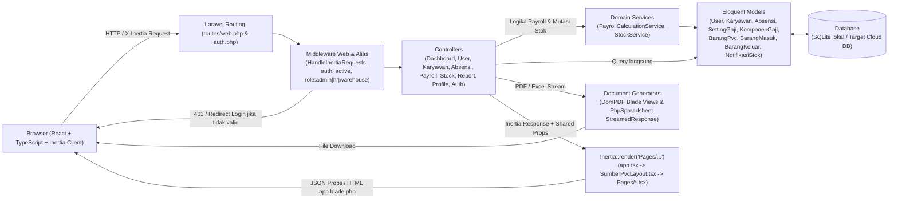

# Arsitektur Sistem Sumber-PVC (TASK-012)

> **Catatan Penting:** Repository GitHub (`Fauziian/Proyek-SumberPVC`, branch `main`) saat ini baru berisi `README.md`. Seluruh analisis kondisi saat ini pada dokumen ini disusun berdasarkan kode referensi yang berada di workspace lokal (`c:\xampp\htdocs\SumberPVC-NEW`), sehingga kode aplikasi tersebut belum terlihat di dalam Pull Request ini. Dokumen SDD (`docs/SDD.md`) di-skip untuk `TASK-012` sesuai keputusan PIC.

---

## 1. Ringkasan Sistem dan Tujuan

**Sumber-PVC** adalah Sistem Informasi Manajemen Pabrik Outsole Sandal Jepit PVC yang berfokus pada integrasi operasional produksi, absensi karyawan, penggajian, dan mutasi stok gudang barang jadi.

**Tujuan utama sistem:**
1. Mendigitalisasi manajemen akun pengguna dan master produk outsole PVC serta tali strap sandal (satuan `kodi`).
2. Mencatat data master karyawan pabrik dan kehadiran harian berbasis waktu kerja (WIB) dengan status `Penuh`, `Setengah Hari`, `Jam Lebih`, dan `Lembur`.
3. Mengotomatisasi perhitungan gaji periode berdasarkan tarif masa kerja (Kategori A `< 5 tahun` dan Kategori B `>= 5 tahun`), memfinalisasi slip, dan menghasilkan slip gaji PDF.
4. Mengelola transaksi barang masuk (`inbound`), barang keluar (`outbound`), dan notifikasi otomatis saat stok menyentuh ambang batas minimum/kritis.
5. Menyediakan dashboard analitik per peran serta ekspor laporan absensi, payroll, dan stok dalam format Excel dan PDF.

---

## 2. Pilihan Teknologi

### Kondisi Saat Ini (dari Kode)
Mengacu pada `composer.json`, `package.json`, `config/database.php`, dan `.env.example`:

| Lapisan | Teknologi & Versi (di Kode) | Peran |
| :--- | :--- | :--- |
| **Runtime & Backend** | PHP `^8.2`, Laravel Framework `^12.0` | Kerangka kerja utama aplikasi web, routing, ORM Eloquent, validasi, session |
| **Autentikasi & Keamanan** | `laravel/breeze` `^2.4`, `laravel/sanctum` `^4.0` | Scaffolding autentikasi session web (login/logout/password) |
| **RBAC Package** | `spatie/laravel-permission` `^6.25` | Paket RBAC terpasang & tabel permission sudah dimigrasikan, namun **belum aktif dipakai di model `User` / middleware route** (lihat Bagian 6) |
| **Bridge Backend–Frontend** | `inertiajs/inertia-laravel` `^2.0`, `@inertiajs/react` `^2.0.0`, `tightenco/ziggy` `^2.0` | SPA monolith tanpa REST API terpisah; helper `route()` di frontend |
| **Frontend & UI** | React `^18.2.0`, TypeScript `^5.0.2`, Tailwind CSS `^3.2.1` (`@tailwindcss/vite` `^4.0.0`), `@headlessui/react` `^2.0.0`, `lucide-react` `^1.31.0`, `recharts` `^3.10.1`, `sonner` `^2.0.8` | Antarmuka halaman TSX, komponen UI, grafik dashboard, toast notifikasi |
| **Build Tool** | Vite `^7.0.7`, `laravel-vite-plugin` `^2.0.0` | Bundling aset React/TypeScript dan CSS |
| **Ekspor Dokumen** | `barryvdh/laravel-dompdf` `^3.1`, `phpoffice/phpspreadsheet` `^5.9` | Generate PDF (slip gaji, laporan absensi, laporan stok) dan Excel (`.xlsx`) |
| **Database** | SQLite (`DB_CONNECTION=sqlite`, `database/database.sqlite` di `.env.example` & `config/database.php`), tersedia konfigurasi koneksi `mysql` / `mariadb` | Penyimpanan data relasional lokal dan pengujian |
| **Pengujian** | `phpunit/phpunit` `^11.5.50` | Feature & Unit testing backend |

### Rencana (Target)
* **Database Produksi:** Migrasi dari SQLite lokal ke database cloud relasional (MySQL / PostgreSQL / cloud DB sesuai target Fase F6 `TASK-029`).
* **Deployment Target:** Serverless deployment pada Vercel melalui entrypoint `api/index.php` (direktori `api/` saat ini masih kosong) dengan streaming langsung untuk unduhan PDF/Excel agar tidak bergantung pada filesystem writable.
* **Integrasi Penuh Spatie RBAC:** Mengaktifkan trait `HasRoles` pada model `User` dan permission granular apabila dibutuhkan di luar pemeriksaan role saat ini.

---

## 3. Arsitektur Tingkat Tinggi

### Kondisi Saat Ini (dari Kode)
Aplikasi menggunakan arsitektur **Server-Driven SPA Monolith** berbasis Laravel 12 + Inertia.js + React. Permintaan HTTP dari browser masuk ke `routes/web.php` atau `routes/auth.php`, melewati middleware `auth`, `active` (`EnsureUserIsActive`), `role:...` (`CheckRole`), dan `HandleInertiaRequests` (yang membagikan `auth.user`, `unread_notifications_count`, dan `flash` ke seluruh halaman React), lalu diteruskan ke Controller -> Service -> Model Eloquent -> Database.



### Rencana (Target)
* Menambahkan `api/index.php` sebagai front controller serverless Vercel di depan `public/index.php`.
* Memastikan seluruh unduhan PDF/Excel dikirim sebagai *streamed response* tanpa menyimpan file sementara ke disk lokal server.

---

## 4. Struktur Folder Aktual

Struktur berikut mencerminkan kondisi file yang **benar-benar ada di workspace lokal** (`c:\xampp\htdocs\SumberPVC-NEW`) saat analisis Langkah 3 dilakukan:

```text
SumberPVC-NEW/
├── api/                                # Kosong (disiapkan untuk entrypoint Vercel api/index.php pada fase deployment)
├── app/
│   ├── Http/
│   │   ├── Controllers/
│   │   │   ├── Auth/                   # 9 controller autentikasi Breeze (Login, Password, Verification, dll.)
│   │   │   ├── AbsensiController.php
│   │   │   ├── Controller.php
│   │   │   ├── DashboardController.php
│   │   │   ├── KaryawanController.php
│   │   │   ├── PayrollController.php
│   │   │   ├── ProfileController.php
│   │   │   ├── ReportController.php
│   │   │   ├── StockController.php
│   │   │   └── UserController.php
│   │   ├── Middleware/
│   │   │   ├── CheckRole.php           # Alias 'role' di bootstrap/app.php
│   │   │   ├── EnsureUserIsActive.php  # Alias 'active' di bootstrap/app.php
│   │   │   └── HandleInertiaRequests.php
│   │   └── Requests/
│   │       ├── Auth/LoginRequest.php
│   │       └── ProfileUpdateRequest.php
│   ├── Models/                         # 9 model: Absensi, BarangKeluar, BarangMasuk, BarangPvc,
│   │                                   # Karyawan, KomponenGaji, NotifikasiStok, SettingGaji, User
│   ├── Providers/AppServiceProvider.php
│   └── Services/
│       ├── PayrollCalculationService.php
│       └── StockService.php
├── bootstrap/app.php                   # Konfigurasi routing & alias middleware ('role', 'active')
├── config/                             # Konfigurasi Laravel standar + permission.php (Spatie)
├── database/
│   ├── database.sqlite                 # File database SQLite lokal
│   ├── factories/UserFactory.php
│   ├── migrations/                     # 16 file migrasi (Laravel base, Spatie permission tables,
│   │                                   # tabel domain PVC/HR/Payroll, serta migrasi penyesuaian skema)
│   └── seeders/
│       ├── DatabaseSeeder.php
│       └── DemoWorkforceSeeder.php
├── docs/
│   └── ARSITEKTUR.md                   # Dokumen arsitektur ini (baru ditambahkan)
├── resources/
│   ├── css/app.css
│   ├── js/
│   │   ├── app.tsx                     # Entrypoint Inertia React + resolvePageComponent('./Pages/**/*.tsx')
│   │   ├── bootstrap.ts
│   │   ├── Components/                 # 13 komponen UI reusable + ProductVariantFields.tsx
│   │   ├── Layouts/
│   │   │   ├── GuestLayout.tsx
│   │   │   └── SumberPvcLayout.tsx     # Sidebar/topbar dinamis berdasarkan auth.user.role
│   │   ├── Pages/
│   │   │   ├── Attendance/Index.tsx
│   │   │   ├── Auth/                   # Login, Register, Forgot/Reset/Confirm Password, VerifyEmail
│   │   │   ├── Employees/Index.tsx
│   │   │   ├── Payroll/                # Index.tsx, Settings.tsx, Show.tsx
│   │   │   ├── Profile/                # Edit.tsx + Partials/*
│   │   │   ├── Reports/Index.tsx
│   │   │   ├── Stock/                  # Index, Master, Available, Incoming, Outgoing, Notifications, WeeklyReport
│   │   │   ├── Users/Index.tsx
│   │   │   └── Dashboard.tsx
│   │   └── types/                      # global.d.ts, index.d.ts, vite-env.d.ts
│   └── views/
│       ├── app.blade.php               # Root template Inertia
│       └── pdf/                        # attendance-report.blade.php, salary-slip.blade.php, stock-report.blade.php
├── routes/
│   ├── auth.php                        # Login, logout, update password (tanpa route register publik)
│   ├── console.php
│   └── web.php                         # Grouping route berdasarkan role: admin, hr, warehouse
└── tests/
    ├── Feature/                        # AttendanceAndPayrollTest, WarehouseStockTest, ProfileTest, Auth/*
    └── Unit/ExampleTest.php
```

**Catatan bagian yang belum ditemukan di workspace lokal:**
* Direktori `docs/SPRINT_WATERFALL.md` dan `docs/sprint_waterfall/*.csv` yang dirujuk oleh `README.md` lokal belum ditemukan.
* File entrypoint `api/index.php` di dalam folder `api/` belum ditemukan.

---

## 5. Modul Utama dan Tanggung Jawabnya

Berdasarkan `routes/web.php`, controller, service, dan halaman React yang ada:

| Modul | Controller & Service | Tanggung Jawab Utama |
| :--- | :--- | :--- |
| **1. Autentikasi & Profil** | `AuthenticatedSessionController`, `PasswordController`, `ProfileController`, `LoginRequest` | Login berbasis `username` + `password`, validasi `is_active`, regenerasi & invalidasi session, pembaruan profil dan kata sandi. |
| **2. Dashboard** | `DashboardController` | Menyajikan ringkasan statistik & grafik sesuai role user (`admin`, `hr`, `warehouse`). |
| **3. Administrasi Sistem & Master Produk** | `UserController`, `PayrollController` (`settings`, `updateSettings`), `StockController` (`master`, `storeItem`, `updateItem`, `destroyItem`) | CRUD akun pengguna, reset password, konfigurasi tarif gaji kategori A/B, CRUD master barang jadi PVC (`Tali Jepit`, `Outsole`, `Boloni Gunung`). |
| **4. HR, Karyawan & Absensi** | `KaryawanController`, `AbsensiController` | CRUD data master karyawan (termasuk kategori masa kerja `A`/`B`), pencatatan absensi harian (`checkIn`, `checkOut`, `destroy`). |
| **5. Penggajian (Payroll)** | `PayrollController`, `PayrollCalculationService` | Kalkulasi gaji per periode (`calculatePeriod`), detail & finalisasi slip gaji (`show`, `finalize`), unduh slip gaji PDF (`downloadPdf`). |
| **6. Gudang & Stok Barang Jadi** | `StockController`, `StockService` | Monitoring stok tersedia, pencatatan transaksi barang masuk (`recordIncoming` / batch) & keluar (`recordOutgoing` / batch), notifikasi stok kritis/menipis (`NotifikasiStok`), laporan mingguan/bulanan. |
| **7. Pelaporan Terpadu** | `ReportController`, `StockController` (ekspor stok) | Ekspor laporan absensi PDF (`DomPDF`), laporan payroll Excel (`PhpSpreadsheet`), dan laporan mutasi stok Excel/PDF. |

---

## 6. Model RBAC (Role, Permission, dan Matriks Akses)

### Kondisi Saat Ini (dari Kode)
* Paket `spatie/laravel-permission` sudah terpasang di `composer.json`, file `config/permission.php` ada, dan migrasi `2026_08_13_083841_create_permission_tables.php` sudah tersedia.
* **Namun di implementasi aktual:**
  * Model `App\Models\User` **belum menggunakan trait `Spatie\Permission\Traits\HasRoles`**.
  * Role disimpan langsung sebagai string pada kolom `users.role` dengan 3 nilai valid: `admin`, `hr`, `warehouse` (migrasi `2026_09_04_030000_replace_management_with_hr_finance.php` memindahkan role lama `management` ke `hr`).
  * Otorisasi di `routes/web.php` menggunakan alias middleware custom di `bootstrap/app.php`:
    * `'active'` -> `EnsureUserIsActive`
    * `'role'` -> `CheckRole` (memeriksa `$request->user()->role` dan `$request->user()->is_active` dari database).
  * Navigasi UI di `SumberPvcLayout.tsx` membaca `auth.user.role` untuk merender menu per peran.

#### Matriks Akses Route Aktual (dari `routes/web.php`)

| Fitur / Grup Route | Endpoint Utama | `admin` | `hr` | `warehouse` | Sumber |
| :--- | :--- | :---: | :---: | :---: | :--- |
| **Dashboard & Profil** | `/dashboard`, `/profile` | Ya | Ya | Ya | Kode (`auth`, `active`) |
| **Manajemen Pengguna** | `/users`, `/users/{user}/reset-password` | Ya | Tidak | Tidak | Kode (`role:admin`) |
| **Pengaturan Tarif Gaji** | `/payroll/settings` | Ya | Tidak | Tidak | Kode (`role:admin`) |
| **Master Produk PVC** | `/admin/master-produk` | Ya | Tidak | Tidak | Kode (`role:admin`) |
| **Lihat Data Karyawan (Admin)** | `GET /admin/employees` | Ya | Tidak | Tidak | Kode (`role:admin`) |
| **Laporan Keseluruhan (Admin)** | `/admin/reports`, ekspor PDF/Excel | Ya | Tidak | Tidak | Kode (`role:admin`) |
| **CRUD Karyawan** | `/employees` (GET, POST, PUT, DELETE) | Tidak | Ya | Tidak | Kode (`role:hr`) |
| **Absensi Harian** | `/attendance`, `check-in`, `check-out` | Tidak | Ya | Tidak | Kode (`role:hr`) |
| **Payroll & Slip Gaji** | `/payroll`, `calculate`, `finalize`, `pdf` | Tidak | Ya | Tidak | Kode (`role:hr`) |
| **Laporan HR/Keuangan** | `GET /reports`, `/reports/attendance/pdf`, `/reports/payroll/excel` | Tidak | Ya | Tidak | Kode (`role:hr`) |
| **Stok Tersedia, Masuk, Keluar, Notifikasi, Laporan Mingguan** | `/stock/available`, `/stock/incoming`, `/stock/outgoing`, `/stock/notifications`, `/stock/weekly-report`, `/stock/report/{excel,pdf}` | Tidak | Tidak | Ya | Kode (`role:warehouse`) |
| **Ekspor Stok Excel Bersama** | `GET /reports/stock/excel` | Tidak | Ya | Ya | Kode (`role:hr,warehouse`) |

### Rencana (Target) — Integrasi Spatie Permission
Jika diaktifkan penuh sesuai judul arsitektur target (`Spatie RBAC`):
* Model `User` akan menggunakan trait `HasRoles` dan memanfaatkan tabel Spatie (`roles`, `permissions`, `model_has_roles`, `role_has_permissions`).
* Permission granular yang direncanakan per domain:
  * `users.manage`, `master-products.manage`, `payroll-settings.manage` (`admin`)
  * `employees.manage`, `attendance.manage`, `payroll.calculate`, `payroll.finalize`, `reports.hr.view` (`hr`)
  * `stock.view`, `stock.incoming.create`, `stock.outgoing.create`, `stock.notifications.manage`, `reports.stock.view` (`warehouse`)
  * `reports.stock.export` (`hr`, `warehouse`, dan `admin` bila diperlukan konsolidasi)
* Pengecekan menggunakan middleware resmi Spatie (`role:...` / `permission:...` atau `$user->can(...)`) dengan mempertahankan guard status `is_active`.

---

## 7. Keamanan

### Kondisi Saat Ini (dari Kode)
1. **Autentikasi Berbasis `username`:** `LoginRequest` mengganti identifier email default Breeze menjadi `username`, menerapkan `RateLimiter` terhadap percobaan gagal, dan menolak user dengan `is_active = false`.
2. **Hashing & Session:** Password di-hash menggunakan `Hash::make` serta cast `'password' => 'hashed'` pada model `User`. Saat login dilakukan `$request->session()->regenerate()`, dan saat logout dilakukan `invalidate()` + `regenerateToken()`.
3. **Otorisasi di Sisi Server:** Middleware `CheckRole` membaca `$request->user()->role` dan `is_active` langsung dari session/database di backend — tidak bergantung pada penyembunyian menu di frontend React. Permintaan Inertia/JSON yang tidak berwenang ditolak dengan HTTP `403`. Middleware `EnsureUserIsActive` otomatis mengeluarkan user yang dinonaktifkan di tengah sesi aktif.
4. **Validasi Input:** Controller memvalidasi payload di server menggunakan `$request->validate(...)` (contoh di `UserController`: `unique:users,username`, `alpha_dash`, `in:admin,hr,warehouse`, `Password::defaults()`).
5. **Pengelolaan `.env`:** File `.env` menyimpan konfigurasi sensitif lokal dan tidak boleh di-commit; `.env.example` menjadi templat variabel lingkungan.

### Rencana (Target)
* Menambahkan `.gitignore` yang secara eksplisit mengecualikan `.env`, `vendor/`, dan `node_modules/` agar kredensial dan artefak dependensi tidak pernah masuk ke repository GitHub.
* Melengkapi audit sesi/token untuk skenario multi-tab dan proteksi CSRF/HTTPS di lingkungan produksi Vercel (`APP_ENV=production`, `APP_DEBUG=false`).

---

## 8. Lingkup yang Belum Diputuskan dan Risiko

### Lingkup yang Belum Diputuskan
1. **Sinkronisasi Kode Lokal ke GitHub:** Repo remote `origin/main` baru berisi `README.md`, sedangkan kode aplikasi lengkap berada di workspace lokal. Perlu keputusan PM/Lead Programmer mengenai jadwal dan urutan PR untuk mendorong kode aplikasi lokal (`TASK-017` s.d. `TASK-024`).
2. **Migrasi Penuh ke Spatie `HasRoles` vs Pertahankan `CheckRole`:** Apakah implementasi RBAC akan direfaktor memakai tabel Spatie (`HasRoles` + `permissions`) atau tetap mempertahankan kolom `users.role` dengan `CheckRole` (mengingat kode, seeder, dan test saat ini mengandalkan `users.role`).
3. **Referensi ERD (`TASK-011`) & Dokumentasi `docs/SPRINT_WATERFALL.md`:** Link bukti ERD pada `TASK-011` belum tertaut di Sheet, dan folder `docs/sprint_waterfall/` yang dirujuk `README.md` belum tersedia.

### Risiko Utama (Diselaraskan dengan `RISK REGISTER` & `BUG & ISSUES`)
1. **Filesystem Read-Only pada Vercel Serverless (`RISK-02`, `BUG-004`):** Lingkungan Vercel tidak mendukung penyimpanan file persisten di disk atau symlink `public/storage`. Ekspor PDF/Excel wajib streaming langsung dan `api/index.php` belum tersedia.
2. **Bug Logika Bisnis & Konsistensi Data (`BUG-001` s.d. `BUG-009`):** Beberapa isu sudah teridentifikasi pada kode referensi (inkonsistensi `kategori_masa_kerja` vs tanggal masuk pada `PayrollCalculationService::calculate`, finalisasi slip saat absensi belum check-out, filter stok kritis di halaman `Available.tsx`, pencatatan stok awal sebagai `BarangMasuk`, dan fallback total gaji bulan lalu di dashboard admin).
3. **Risiko Kebocoran File Lokal Tanpa `.gitignore`:** Sebelum `.gitignore` di-commit, seluruh file sensitif/dependensi lokal berisiko ikut ter-stage jika tidak dikontrol ketat per file.
4. **Bottleneck Integrasi & Review (`RISK-03`):** Pembagian tugas coding ke tiga programmer membutuhkan review PR terstruktur sebelum merge ke `main`.
